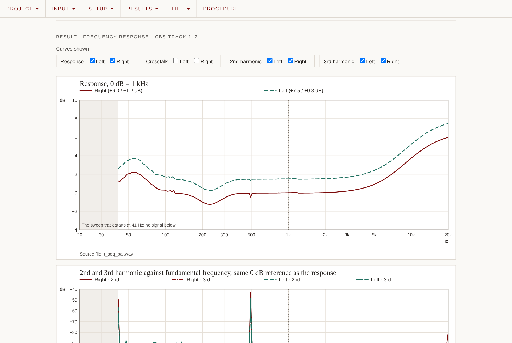
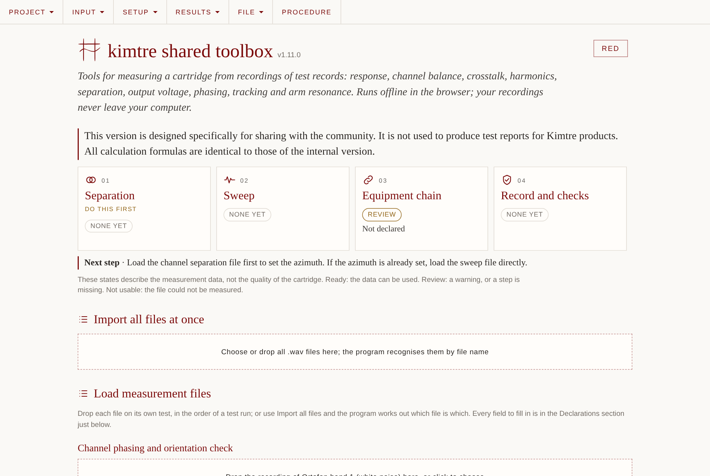

# kimtre shared toolbox

Tools for measuring a phono cartridge from recordings of test records: frequency response, channel balance, crosstalk, harmonics, channel separation, output voltage, channel phasing, tracking ability and tonearm resonance. It is one HTML file. It runs offline in the browser, and your recordings never leave your computer.

*The chart above comes from a synthetic test recording, not from a real cartridge.*

This version is designed specifically for sharing with the community. It is not used to produce test reports for Kimtre products. All calculation formulas are identical to those of the internal version.

## Use it

- Open `index.html` in a browser, or download it and open it from your disk. Nothing needs installing and there is no server.
- If the repository has GitHub Pages switched on, the same page is served at `https://<account>.github.io/<repository>/`.
- Record the tracks of your test records (WAV files), then follow the **Procedure** entry in the top bar. It walks through each test in the order of a test run and says which file goes where.

## What it measures

| Test | Test record track |
| --- | --- |
| Channel orientation and phasing | Ortofon, band 1 |
| Channel separation | Ortofon, band 2 |
| Tracking ability | Ortofon bands 6 and 7, CBS side 2 bands 4 and 5 |
| Tonearm resonance | Ortofon bands 8 and 9 |
| Frequency response, balance, crosstalk, harmonics | CBS side 1 bands 1 and 2 |
| Output voltage | CBS side 1 bands 6 and 7, with a reference recording of a known level |
| Tonearm effective mass | Typed-in measurements; no recording needed |

You can also declare a test record of your own: enter its start, end, corner and reference frequencies, give it a name, and it joins the test record list.

## Other things it does

- **Equipment chain.** Declare turntable, arm, step-up transformer, phono stage and ADC gains once; the voltage and level results use them.
- **Project files.** Save the declarations and computed results to one file and open it later. The recordings themselves are not stored in the project.
- **Reports.** Export a report as HTML, choosing which blocks it contains.
- **Import all files at once.** Pick every WAV file together; the program recognises each one from its file name.

## Notes

- The page is plain ES5 JavaScript with no external libraries or network calls, so it also opens on older browsers.
- Settings and your own test records are kept in the browser's local storage, on your machine only.
- The measurement results depend on your recording chain and test records. The program reports what is in the recording; it does not certify a cartridge.

## Licence

MIT, see `LICENSE`. The kimtre name and logo are not covered by the licence.
